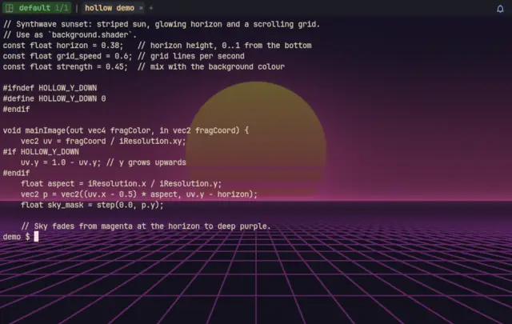

# Background and transparency

Hollow can draw a shader or an image behind the terminal and make the window translucent.
These settings live under the `background` config table.

## Window opacity

```lua
hollow.config.set({
  background = { opacity = 0.85 },
})
```

`opacity` ranges from `0` (fully transparent) to `1` (opaque, the default).
It applies to the default terminal background.
Top and bottom bar base fills preserve the background's transparency.
Text, cells with an explicit background colour, the cursor, selections and Lua UI stay opaque.

The window surface is chosen when Hollow starts.
Set `opacity` below `1` in your config file and restart to turn transparency on.
After that, `hollow.config.reload()` can change the value, but raising it to `1` keeps the transparent surface until the next restart.

Platform notes:

- Windows 10 and later present through DirectComposition.
  Older versions fall back to an opaque window.
- Linux needs a compositing window manager.
  Hollow asks GLX for a 32-bit ARGB visual and falls back to an opaque one when none exists.

## Windows Acrylic and Mica

Windows 11 22H2 (build 22621) or later supports native system backdrops:

```lua
hollow.config.set({
  background = {
    backdrop = "acrylic", -- "none" | "acrylic" | "mica" | "mica_alt"
    opacity = 0.8,
  },
})
```

- `acrylic` is frosted glass that blurs the desktop and windows behind Hollow.
- `mica` is a subtle wallpaper-derived material, not a live blur of other windows.
- `mica_alt` is a stronger-tinted Mica variant.
- `none` (the default) removes the material without changing window opacity.

Set `opacity` below `1` in your startup config and restart.
The backdrop setting does not change opacity automatically.
With a transparent surface, `backdrop` can change without a restart.
Use config reload or `hollow.config.set()` to switch materials.
An opaque background hides the material.

The material sits beneath shaders, images, overlays and terminal content.
With a material active, Windows' solid caption-color override is disabled.
Opaque images or overlays can cover it.
Custom post-process shaders must preserve alpha.
Windows controls tint, blur and accessibility or power-saving fallbacks.
Enable Windows **Transparency effects** to see translucent materials.
Find it under **Settings → Personalization → Colors**.
Hollow does not expose a native blur radius.
Unsupported Windows versions retain existing transparency.
They log a warning when a material is requested.
Other platforms ignore `backdrop`.

## Background image

```lua
hollow.config.set({
  background = {
    image = {
      path = "C:/Users/me/Pictures/wallpaper.jpg",
      fit = "cover",   -- "cover" | "contain" | "stretch" | "tile" | "center"
      opacity = 0.4,
    },
  },
})
```

`image` also accepts a bare path string, which uses `fit = "cover"` and `opacity = 1`.
Set it to `false` to remove the image.

- Formats: PNG and JPEG.
- Limits: 64 MiB per file and 8192 pixels per side.
- Use an absolute path; relative paths resolve against Hollow's working directory.

| `fit`     | Behaviour                                              |
| --------- | ------------------------------------------------------ |
| `cover`   | Scale to fill the window, cropping the overflow        |
| `contain` | Scale to fit inside the window                         |
| `stretch` | Stretch to the window size, ignoring the aspect ratio  |
| `tile`    | Repeat at native size from the top-left corner         |
| `center`  | Native size, centred                                   |

The image sits under the terminal, so `image.opacity` blends it with the background colour.
With `background.opacity` below `1`, the desktop shows through wherever the image is transparent or dim.

A file that fails to load is logged once and skipped.
Change the path or reload the config to try again.


Background photo: Bubble Nebula, NASA, ESA and the Hubble Heritage Team (STScI/AURA).

## Background shader

```lua
hollow.config.set({
  background = {
    shader = {
      path = "C:/Users/me/shaders/aurora_background.glsl",
      opacity = 1,     -- blend shader with the background colour
      brightness = 0.3, -- dim the shader towards black
      animate = true,  -- request redraws for animation
      max_fps = 30,   -- background refresh cap (default 60), independent of terminal FPS
      render_scale = 0.5, -- optional half-resolution background shader
    },
  },
})
```

`shader` also accepts a bare path string, which uses `opacity = 1`, `animate = true`, and `max_fps = 60`.
Set it to `false` to remove the shader.

Background shaders use the same Ghostty-compatible GLSL as [custom shaders](custom-shaders.md#writing-shaders), with the same uniforms.
The differences:

- `iChannel0` is an empty texture; there is no scene to sample yet.
- The shader takes the place of the background colour. Its alpha is ignored; `opacity` mixes it with the background colour.
- `brightness` multiplies the shader's RGB before that blend: `0` is black and `1` (the default) leaves it unchanged.
  Use it to dim a shader without fading it towards a lighter background colour.
- `background.opacity` still sets the window transparency, so the desktop shows through the shader too.
- The layers stack as: background colour, shader, image, overlay, then the terminal.
  Give the image an `opacity` below `1` to let the shader show through.

Hollow renders an animated background shader into a cached layer and refreshes it at most `max_fps` times per second, 60 by default.
Terminal redraws are not capped; frames between refreshes reuse the cached layer.
Set `max_fps` to 1–240 to change the cap.
For a slow decorative background, `max_fps = 30` saves more GPU time; on one integrated GPU, 30 used about a third of the uncapped load and 60 about half.
Set `max_fps = 0` to remove the cap.
An animated, full-resolution shader then draws directly on every rendered frame; static and scaled shaders still use the cache when supported.
The cache adds one GPU texture and a composite draw per rendered frame, so very cheap shaders may run faster uncapped.
Set `animate = false` for static shaders; Hollow renders them once into a cached layer and re-renders only on resize or a layer change, such as window opacity.

Set `render_scale` below `1` to render the background shader at a lower resolution and upscale it with linear filtering.
Values are clamped to `0.25`–`1`; `0.5` halves each axis, so the shader runs on about one quarter of the pixels.
`iResolution`, pixel coordinates, and cursor rectangles are relative to that smaller target.
Text, images, overlays, and post-processing stay at full resolution.
This works well for soft effects like aurora, but may blur sharp patterns.
Scaling works with or without `max_fps`; without a cap, the smaller target is refreshed on each rendered frame.
If the GPU cannot use the scaled target, Hollow falls back to direct rendering.
Plugins can request a frame explicitly with `hollow.ui.request_redraw()`.
This requests a redraw; it does not recompile an edited shader file.

The shader compiles when the config sets `background.shader`.
Run `hollow.config.reload()` after editing it.
A shader that fails to compile is skipped and the error goes to the log file.

[`examples/shaders/`](../examples/shaders/) has background shaders to start from:

- `aurora_background.glsl`: slow aurora bands.
- `matrix_rain.glsl`: falling green glyph rain.
- `synthwave.glsl`: a striped sunset over a scrolling neon grid.

Each has constants at the top, such as `strength`, to tone it down behind text.




## Solid color overlay

Use an overlay to tint a shader or image and soften its contrast without changing the shader:

```lua
hollow.config.set({
  background = {
    overlay = { color = "#242038", opacity = 0.5 },
  },
})
```

The overlay is drawn above the shader and image, but below terminal content.
Its `opacity` ranges from `0` to `1` and defaults to `1`.
Set `overlay = false` to remove it.
It preserves window transparency; explicit terminal cell backgrounds can still cover it.

## Cell background opacity

Programs such as Neovim paint their own background colours on cells, which hide the layers behind them.
Use `cell_opacity` to let those colours show the shader, image or overlay through:

```lua
hollow.config.set({
  background = {
    cell_opacity = 0.7,
  },
})
```

It ranges from `0` to `1` and defaults to `1` (opaque).
It applies only when a shader, image, overlay or window transparency is set.
Cells using the theme background colour stay fully clear.
Floating terminal panes are an exception: their backgrounds stay opaque so text in the panes underneath does not show through.
Selection, search matches and the block cursor stay opaque.
This keeps highlights such as an inactive-window background, diff colours or the cursor line visible while the background still shows through.

### Powerline separator opacity

Powerline prompts use foreground glyphs to join coloured background segments.
Normally these glyphs stay opaque even when `cell_opacity` fades the backgrounds.
Enable `powerline_opacity` to fade each separator and its background together:

```lua
hollow.config.set({
  background = {
    opacity = 0.8,
    cell_opacity = 0.45,
    powerline_opacity = true,
    powerline_glyphs = { "◀", "▶" }, -- optional additions to the default set
  },
})
```

The built-in set is U+E0B0 through U+E0BF, inclusive.
It includes triangular, rounded and diagonal Powerline separators.
`powerline_glyphs` extends this set; it never replaces the built-in characters.
Each entry must be one valid Unicode scalar with terminal width one.
At most 128 entries are accepted; duplicates are ignored.
Setting an empty table clears the extensions.
Changing the extension list replaces the previous extensions.

The option defaults to `false`, preserving normal foreground rendering.
At `cell_opacity = 1` it has no effect.
Ordinary prompt text stays opaque unless its character was explicitly added.
Selection, search highlights, cursors and quick-select overlays are not faded.
The normal cached renderer supports this effect.
Diagnostic direct/safe rendering paths leave separator glyphs opaque.

The cell is composited first and faded once, including between coloured segments.
This avoids double-blending the separator over an already translucent background.
The effect does not require Oh My Posh or a particular shell.

## See also

- [Configuration](configuration.md)
- [Custom shaders](custom-shaders.md)
- [`hollow.config` reference](reference/lua/config.md#background)
