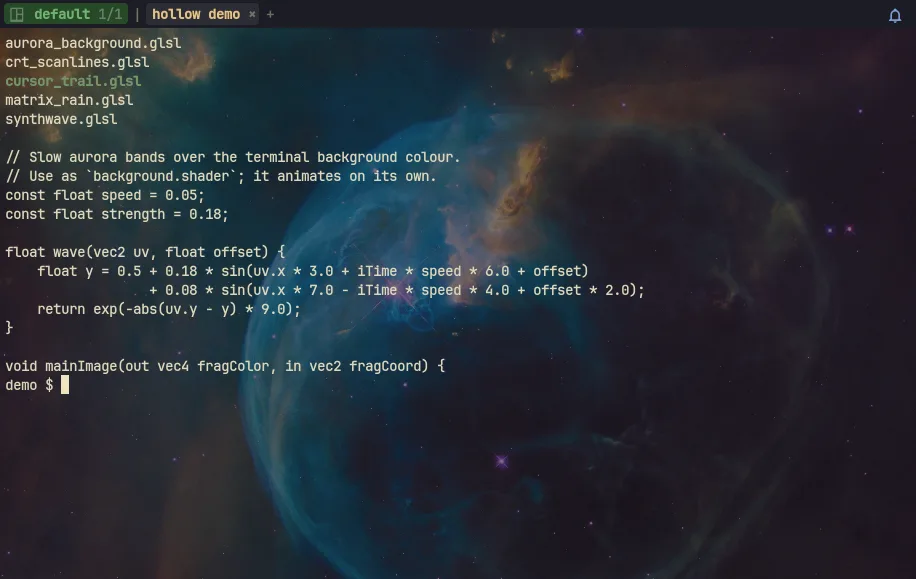
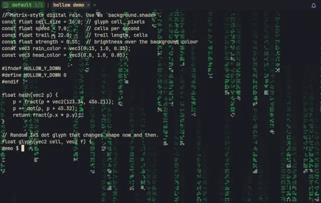
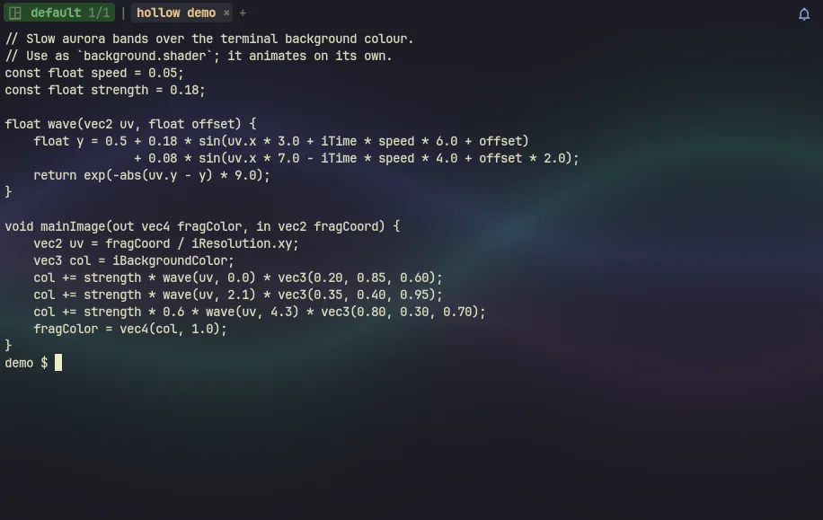

# Background and transparency

Hollow can draw a shader or an image behind the terminal and make the window translucent.
All three live under the `background` config table.

## Window opacity

```lua
hollow.config.set({
  background = { opacity = 0.85 },
})
```

`opacity` ranges from `0` (fully transparent) to `1` (opaque, the default).
It applies to the default terminal background only.
Text, cells with an explicit background colour, the cursor, selections and Lua UI stay opaque.

The window surface is chosen when Hollow starts.
Set `opacity` below `1` in your config file and restart to turn transparency on.
After that, `hollow.config.reload()` can change the value, but raising it to `1` keeps the transparent surface until the next restart.

Platform notes:

- Windows 10 and later present through DirectComposition.
  Older versions fall back to an opaque window.
- Linux needs a compositing window manager.
  Hollow asks GLX for a 32-bit ARGB visual and falls back to an opaque one when none exists.

## Background image

```lua
hollow.config.set({
  background = {
    image = {
      path = "C:/Users/me/Pictures/wallpaper.jpg",
      fit = "cover",   -- "cover" | "contain" | "stretch" | "tile" | "center"
      opacity = 0.4,
    },
  },
})
```

`image` also accepts a bare path string, which uses `fit = "cover"` and `opacity = 1`.
Set it to `false` to remove the image.

- Formats: PNG and JPEG.
- Limits: 64 MiB per file and 8192 pixels per side.
- Use an absolute path; relative paths resolve against Hollow's working directory.

| `fit`     | Behaviour                                              |
| --------- | ------------------------------------------------------ |
| `cover`   | Scale to fill the window, cropping the overflow        |
| `contain` | Scale to fit inside the window                         |
| `stretch` | Stretch to the window size, ignoring the aspect ratio  |
| `tile`    | Repeat at native size from the top-left corner         |
| `center`  | Native size, centred                                   |

The image sits under the terminal, so `image.opacity` blends it with the background colour.
With `background.opacity` below `1`, the desktop shows through wherever the image is transparent or dim.

A file that fails to load is logged once and skipped.
Change the path or reload the config to try again.



Background photo: Bubble Nebula, NASA, ESA and the Hubble Heritage Team (STScI/AURA).

## Background shader

```lua
hollow.config.set({
  background = {
    shader = {
      path = "C:/Users/me/shaders/aurora_background.glsl",
      opacity = 1,     -- 0..1
      animate = true,  -- render every frame
    },
  },
})
```

`shader` also accepts a bare path string, which uses `opacity = 1` and `animate = true`.
Set it to `false` to remove the shader.

Background shaders use the same Ghostty-compatible GLSL as [custom shaders](custom-shaders.md#writing-shaders), with the same uniforms.
The differences:

- `iChannel0` is an empty texture; there is no scene to sample yet.
- The shader takes the place of the background colour. Its alpha is ignored; `opacity` mixes it with the background colour.
- `background.opacity` still sets the window transparency, so the desktop shows through the shader too.
- The layers stack as: background colour, shader, image, then the terminal.
  Give the image an `opacity` below `1` to let the shader show through.

`animate = true` renders every frame, which keeps the GPU busy.
Set it to `false` for static shaders; they then redraw only when the terminal changes.

The shader compiles when the config sets `background.shader`.
Run `hollow.config.reload()` after editing it.
A shader that fails to compile is skipped and the error goes to the log file.

[`examples/shaders/`](../examples/shaders/) has background shaders to start from:

- `aurora_background.glsl`: slow aurora bands.
- `matrix_rain.glsl`: falling green glyph rain.
- `synthwave.glsl`: a striped sunset over a scrolling neon grid.

Each has constants at the top, such as `strength`, to tone it down behind text.






## See also

- [Configuration](configuration.md)
- [Custom shaders](custom-shaders.md)
- [`hollow.config` reference](reference/lua/config.md#background)
