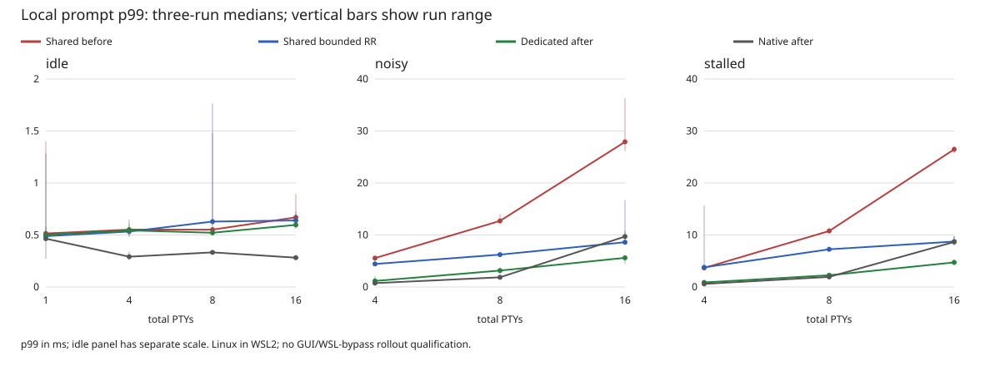

# Shared PTY experiment: initial 1/4/8/16-session step

This is the first bounded E2/E3 experiment, not completion of the architecture
plan's multiplexing milestone. Pane selection remains dedicated. No production
defaults, Lua policy, job limits or persistence contracts change.

## What runs

The existing headless benchmark accepts `native` (Linux POSIX PTYs), `agent`
(one agent per PTY), and `shared` (one agent connection for all PTYs). One
foreground PTY runs the same byte-checked prompt/throughput workload as before.
The other `sessions - 1` PTYs are:

* `idle`: waiting in `sleep` after a checked startup greeting;
* `noisy`: continuously emitting distinct byte values, one value per background
  stream, so routing/interleaving corruption fails the run;
* `stalled`: the first background emits output but is never consumed; remaining
  backgrounds emit the same checked continuous output as `noisy`.

All sessions finish the startup handshake before load starts. Each experiment
uses fresh PTYs and checks the foreground's exact echo/output SHA-256 and clean
exit. Background streams are intentionally cancelled at teardown, not counted as
cleanly completed output transfers. A source emits up to 1 GiB before sleeping;
longer experiments must not mistake that finite source for indefinite readiness.
`spawn_to_ready_ns` covers only the foreground, not full group startup. Shared
owner creation precedes that timer; these data do not qualify startup parity.

The same owner loop reads foreground first and then at most 16 KiB from each
background, once per foreground receive iteration. It does not wait while any
background made progress. This is an explicit harness scheduling policy, not
Hollow's window/GPU/active-workspace scheduler. There are no wire focus hints yet.
Production native reader buffers remain 4 MiB; agent per-session buffers remain
64 KiB. This compares the real backends, not artificially identical queue sizes.

Every result labels session count, load, allocator and backend. It reports raw
foreground latency samples, foreground throughput, bytes delivered per background,
maximum observed delivery gap per stream, background measurement duration and
stalled-consumer pending bytes. Background counters cover warmups too; the 32
checked foreground prompt warmups remain excluded from latency distributions.
The runner rejects zero progress in any consuming noisy stream and nonzero
consumption of an idle/stalled stream. A nonzero byte total alone is not a
starvation qualification: inspect delivery gaps, duration and distribution too.

## Findings and scheduler experiment

The initial correctness matrix passes with 16 long-lived spawns plus concurrent
input/resize RPCs, isolated completions, close/replacement and owner-first teardown.
An early one-run/200-sample smoke exposed substantial noisy-neighbor latency:
16 shared PTYs reached about 23 ms prompt p99, versus about 4 ms with dedicated
agents. Idle sharing remained sub-millisecond in that smoke. These are diagnostic
observations, not repeated qualification data.

The original scheduler could queue roughly 1 MiB of PTY DATA, in fixed job order,
ahead of a newly dispatched input ACK or foreground output. The candidate change
limits queued PTY bulk to roughly 64 KiB, uses 16 KiB per-session quanta with a
rotating cursor, and preserves the existing 64 KiB budget when only one PTY has
ready, credited output. It keeps the pre-poll scheduling fix, negotiated frame/credit limits,
single-writer partial-frame ordering and the global 4 MiB safety cap. Existing
filesystem results can still queue more than this PTY-specific budget; mixed
filesystem bulk remains a separate experiment.

Deterministic agent-loop tests verify that all 16 continuously credited captures
make progress across four drained batches, that the batch bound holds, and that
one zero-credit capture cannot block the others.

## Repeated results

Two full matrices, three runs each, 1,000 recorded prompt exchanges per run and
10 MiB foreground output, GUI-matched DebugAllocator, runtime telemetry disabled.
Each stage contains 180 measurements; no measurements or slow runs were removed.
Both stages use the same checked client and owner scheduling. The agent scheduler
change is isolated by preserved source patches and executable hashes.

Prompt p99 below is the **median of three per-run p99 values**, not pooled latency:

| Total PTYs | Load | Native after, ms | Dedicated after, ms | Shared before, ms | Shared bounded RR, ms |
| ---: | --- | ---: | ---: | ---: | ---: |
| 1 | idle | 0.464 | 0.502 | 0.515 | 0.489 |
| 4 | idle | 0.291 | 0.544 | 0.552 | 0.533 |
| 8 | idle | 0.333 | 0.521 | 0.552 | 0.629 |
| 16 | idle | 0.282 | 0.597 | 0.670 | 0.640 |
| 4 | noisy | 0.744 | 1.160 | 5.557 | 4.426 |
| 8 | noisy | 1.860 | 3.160 | 12.714 | 6.222 |
| 16 | noisy | 9.707 | 5.608 | 27.917 | 8.610 |
| 4 | stalled | 0.591 | 0.877 | 3.663 | 3.784 |
| 8 | stalled | 1.943 | 2.258 | 10.771 | 7.245 |
| 16 | stalled | 8.663 | 4.725 | 26.477 | 8.741 |



The bounded scheduler improves 16-PTY noisy median p99 by **3.24×**, but does not
establish latency parity. Five of 18 loaded shared/native pairs still exceed a
local +5 ms p99 comparison: one 4-PTY stalled run (+15.08 ms), all three 8-PTY
stalled runs (+5.30–5.63 ms), and one 16-PTY noisy run (+5.97 ms). The 4-PTY stalled
shared run reaches 15.67 ms p99, worse than every corresponding pre-change run;
the 16-PTY noisy range is 8.50–16.71 ms. These tails remain in the data. This local
check uses POSIX PTYs, **not** the plan's required legacy WSL-bypass comparator.

All consuming noisy streams delivered checked bytes; the stalled shared consumer
stayed exactly at 65,536 pending bytes in every run. The worst post-change shared
background delivery gap is **80.31 ms**, versus 61.14 ms before. Thus the reduced
median foreground latency is not evidence that tail fairness improved in every
run. Longer stress, dispatch instrumentation and focus-aware scheduling remain
necessary before declaring background starvation/fairness gates passed.

Shared foreground and aggregate output must be read separately:

| Total PTYs | Load | Foreground before/after, MiB/s | Aggregate before/after, MiB/s |
| ---: | --- | ---: | ---: |
| 4 | noisy | 19.92 / 19.05 | 72.66 / 75.93 |
| 8 | noisy | 9.01 / 9.31 | 65.65 / 74.16 |
| 16 | noisy | 3.54 / 4.46 | 55.25 / 71.62 |
| 16 | stalled | 3.95 / 4.56 | 56.73 / 68.35 |

Aggregate includes foreground plus background bytes during the background
measurement interval. For idle backgrounds, the final shared foreground medians
are 68.28 / 73.10 / 65.24 / 71.01 MiB/s at 1/4/8/16 PTYs. The shared pipe has finite
bandwidth: roughly 4.46 MiB/s per busy stream at 16-way load is not comparable to
a lone PTY's 70 MiB/s without also reporting aggregate throughput and fairness.

A separate five-run dedicated E1 recheck uses 5,000 prompt samples and 10/100 MiB
output with the new scheduler. Agent/native median throughput is **96.9%/97.0%**,
and median prompt p99 is 0.610/0.308 ms. This preserves near-native median evidence,
not a universal 95% pass: one 10 MiB run is only 53.72 versus 68.27 MiB/s native,
and one 100 MiB pair also falls below 95%.

**Decision: keep the bounded scheduler as an experimental research improvement;
reject shared-pane rollout.** Next experiments need focus-aware priorities,
mixed fs bulk and tail/fairness instrumentation, not relaxed latency thresholds.

### Preserved evidence

* [Before: 180 measurements](2026-10-18-shared-before.jsonl.gz), raw SHA-256
  `f38dc9738ddfd5a0015820ac9e153cef164943489460435ffbe9db9b6ee3c01a`
* [After: 180 measurements](2026-10-18-shared-after.jsonl.gz), raw SHA-256
  `846386d29103ce8d26fd79fc0824ec33a56e7da7d96c907d068fc04aacb18876`
* [Dedicated E1 recheck: 30 measurements](2026-10-18-shared-scheduler-e1.jsonl.gz),
  raw SHA-256 `6f1b257ac2ee86728081d3e8fde866ac44acf8cfb24002ddf51f8c9ecc988594`
* [Machine-readable summary](2026-10-18-shared-summary.json): per-run values,
  ranges, paired deltas, per-stream throughput, delivery gaps and executable hashes.
* [Before source patch](2026-10-18-shared-before.patch.gz) and
  [after source patch](2026-10-18-shared-after.patch.gz), both against `d7710f8`.
  Applying each to the base and hashing reconstructed sources verifies every
  source hash listed in its raw dataset. The after patch also reconstructs the
  dedicated E1 recheck's measured source files.

Correctness: 120 native test executions across standalone targets (including
imported tests), 52 Python harness unit tests, 16 fs/exec conformance cases,
11 real PTY lifecycle cases, real pane/terminal integration and native Lua in both
installed layouts pass. The adapter suite, including shared cases, passes locally,
through rootless Podman, WSL interop and the fragmented mock socket. Static
x86_64/aarch64 agents and Windows adapter/benchmark compile checks pass; this is
not ARM64 execution or native Windows GUI testing.

## Reproduce

```sh
zig build --build-file build-agent.zig agent agent-pty-bench -Doptimize=ReleaseFast
python3 scripts/agent_pty_bench.py --backend all --sessions 1 4 8 16 --load idle noisy stalled --runs 3 --samples 1000 --size-mib 10 --output shared.jsonl
zig build --build-file build-agent.zig test-agent-loop test-agent-pty test-host-transport -Doptimize=ReleaseSafe
```

The runner alternates backend ordering across independent runs and records source
and binary hashes plus the exact command/environment. `--backend both` retains
the original native/dedicated comparison. `--backend shared` limits execution to
the shared experiment. Single-session noisy/stalled combinations are skipped
because they have no neighbor. The existing prepared-connector override also
applies. If every requested case would be skipped, argument validation fails
before launching binaries or creating an empty dataset. The prepared connector
does not add remote bootstrap or turn Linux numbers into Windows data.

Remaining gates: repeated per-stream/aggregate fairness under longer workloads,
filesystem bulk, focus hints and input/resize queue latency, CPU/RSS scaling,
fault injection under load, 40/100/200 PTYs, native Windows GUI and actual WSL
bypass comparison. No result in this report authorizes shared-pane rollout.
