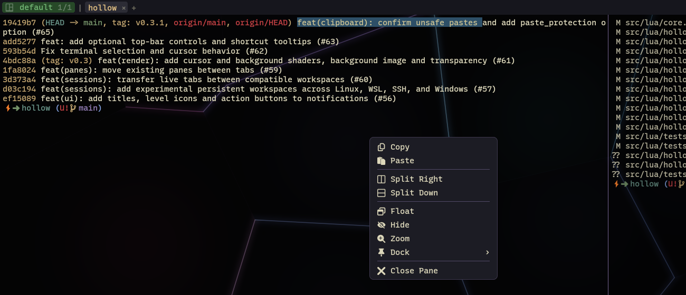
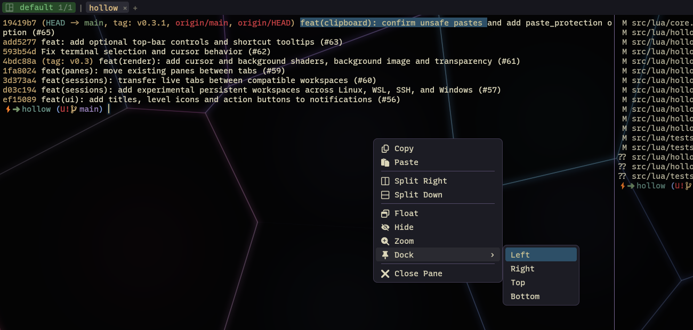
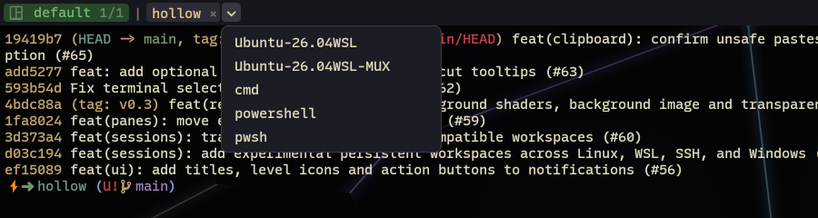

# Context menus

Right-click a terminal pane to open its menu without changing the active pane.
If the program has enabled mouse reporting, Hollow sends right-click to the program instead, even when Hollow has a selection.
Shift+right-click opens Hollow's menu either way.



The menu offers Copy, Paste, Split Right, Split Down, Float/Unfloat, Hide, Zoom/Unzoom, Dock/Undock, and Close Pane.
Unavailable actions remain visible but disabled.
Dock opens a submenu for the workspace's left, right, top, or bottom edge.
Occupied edges are disabled.
Undock is a direct action.



Click a submenu row or press Right or Enter to open it; Left or Escape returns to the parent without copying.
Rows activate when you release the mouse button over them, so you can press, drag to a row, and release.
Use the mouse wheel to scroll, or use Up and Down to move between available items and Enter to choose one.
Escape or a left or middle click outside the menu dismisses it and copies and clears the clicked pane's selection only if it is the same selection that existed when the menu opened.
Choosing an action or losing the menu's target does not trigger this automatic copy.
Right-clicking outside the menu closes it without copying and handles that right-click as usual, so right-clicking another pane opens its menu.
Paste from the menu targets the clicked pane; if the text is unsafe, Hollow asks for confirmation as it does for a keyboard paste.
Notifications that arrive while the menu is open appear beneath it and do not close it.

Shift+click the top-bar `+` to choose the domain for a new tab.
With one configured domain, Hollow selects it directly; with none, nothing happens.
Plain click still opens a tab normally, and other domain actions still use the searchable picker.



## Customize the terminal menu

Set `terminal_menu_items` to replace the list and control its order.
Custom callbacks receive a snapshot of the clicked pane, not necessarily the active pane.
Set `icon` on a custom entry to give it a leading glyph.

```lua
hollow.config.set({
  terminal_menu_items = {
    "copy",
    "paste",
    "separator",
    "split_right",
    { label = "Ring bell", action = function(pane) hollow.term.bell(pane.id) end },
    "close",
  },
})
```

To restore legacy terminal right-click behavior, including right-click-to-copy, use:

```lua
hollow.config.set({ terminal_menu = false })
```

This does not disable the top-bar domain menu or `hollow.ui.menu`.
When building a menu with `hollow.ui.menu`, an item can specify a `submenu` list instead of an `action`.
