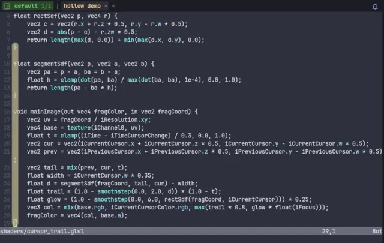

# Custom shaders

Hollow runs Ghostty-compatible post-process shaders over the rendered window.
Cursor trails, CRT effects and colour grading written for Ghostty work unchanged.

## Configuration

```lua
hollow.config.set({
  custom_shader = {
    "C:/Users/me/shaders/cursor_smear.glsl",
    "C:/Users/me/shaders/crt.glsl",
  },
  shader_animation = "cursor",
})
```

`custom_shader` accepts a path, a list of up to 8 paths, or `false` to turn shaders off.
Shaders run in order: each one samples the output of the previous one.
Use absolute paths; relative paths resolve against Hollow's working directory.

`shader_animation` controls when Hollow renders frames that nothing else asked for:

| Value                | Behaviour                                                       |
| -------------------- | --------------------------------------------------------------- |
| `"cursor"` (default) | Keep rendering for one second after the cursor or focus changes |
| `"always"` or `true` | Render every frame, for shaders that animate on their own       |
| `"off"` or `false`   | Render only when the terminal changes                           |

Shader files are compiled when the config sets `custom_shader`.
After editing a shader, run `hollow.config.reload()` to recompile it.
If any pass fails to load, Hollow keeps the previous post-process chain intact.
A failed background shader replacement likewise keeps the previous background shader.
Hollow shows a notification and logs the error; if no previous shader was loaded, the failed layer stays off.
If allocating the post-process render targets fails, Hollow draws the frame directly and retries at a new window size or on shader reload.

## Validate before applying

Use `hollow.shader.validate(path)` to check a selected file without applying it:

```lua
local result = hollow.shader.validate(path)
if not result.valid then
  hollow.ui.notify.error(result.message)
  return
end
hollow.config.set({ custom_shader = path })
```

Validation uses Hollow's real Shadertoy wrapper and native compiler target.
It catches missing `mainImage`, GLSL errors, and backend translation failures.
It does not change the active shaders or create GPU resources.
The same validation works for background and post-process shaders.

This is synchronous: validate on selection, not every frame or picker redraw.
Files are limited to 256 KiB and diagnostics to 4096 bytes.
GPU creation can still fail later, and compilation cannot guarantee appearance.
For example, a valid shader can still discard the window's transparency.

See [`hollow.shader`](reference/lua/shader.md) for result codes and path rules.

### Live picker previews

Use `on_selection_changed` to preview the highlighted shader.
Restore the original configuration on unmount unless an action accepted it:

```lua
local original = hollow.config.get("custom_shader")
local accepted = false
local previewed
hollow.ui.select.open({
  items = shader_paths,
  on_selection_changed = function(path)
    previewed = nil
    if path and hollow.shader.validate(path).valid then
      previewed = path
      hollow.config.set({ custom_shader = path })
    else
      hollow.config.set({ custom_shader = original or false })
    end
  end,
  actions = {
    {
      name = "Apply",
      fn = function(path)
        if path and path == previewed then
          accepted = true
          hollow.ui.select.close()
        end
      end,
    },
  },
  on_unmount = function()
    if not accepted then
      hollow.config.set({ custom_shader = original or false })
    end
  end,
})
```

The callback also runs for the initial selection and receives `nil` for no matches.
For large collections, cache validation results or debounce previews in the plugin.
Invalidate cached results when files change.
Cancel pending preview work on unmount so it cannot overwrite the accepted shader.

## Examples

[`examples/shaders/`](../examples/shaders/) has shaders to start from:

- `cursor_trail.glsl` draws a fading trail behind the cursor and a soft glow around it.
- `crt_scanlines.glsl` adds faint scanlines and an RGB fringe.

The included trail reads `cursor.trail` from Lua.
`decay` is in milliseconds (default `300`, maximum `10000`, `0` disables the trail), `min_distance` is the minimum movement in framebuffer pixels (default `0`), and `color` defaults to the cursor color.
Use `color = false` to return to the cursor color, or `trail = false` to reset all trail settings.




[Background shaders](background.md#background-shader) draw under the terminal instead of over it:

- `aurora_background.glsl` draws slow aurora bands.
- `matrix_rain.glsl` draws falling green glyph rain.
- `synthwave.glsl` draws a striped sunset over a scrolling neon grid.

Chain them to try both:

```lua
local shaders = "/path/to/hollow/examples/shaders/"
hollow.config.set({
  custom_shader = { shaders .. "cursor_trail.glsl", shaders .. "crt_scanlines.glsl" },
})
```

## Writing shaders

Shaders use the Shadertoy entry point:

```glsl
void mainImage(out vec4 fragColor, in vec2 fragCoord) {
    vec2 uv = fragCoord / iResolution.xy;
    vec4 color = texture(iChannel0, uv);
    fragColor = vec4(color.rgb * vec3(1.0, 0.9, 0.8), color.a);
}
```

`iChannel0` holds the terminal frame, or the previous shader's output.
Do not declare uniforms yourself; Hollow provides them.

| Uniform                       | Type           | Meaning                                          |
| ----------------------------- | -------------- | ------------------------------------------------ |
| `iResolution`                 | `vec3`         | Framebuffer size in pixels                       |
| `iTime`, `iTimeDelta`         | `float`        | Seconds since the shaders loaded, frame time     |
| `iFrame`, `iFrameRate`        | `int`, `float` | Frame counter and rate                           |
| `iDate`                       | `vec4`         | Year, month (0-based), day, seconds of day (UTC) |
| `iCurrentCursor`              | `vec4`         | Cursor rectangle: `xy` corner, `zw` size         |
| `iPreviousCursor`             | `vec4`         | Cursor rectangle before the last move            |
| `iCurrentCursorColor`         | `vec4`         | Cursor colour                                    |
| `iPreviousCursorColor`        | `vec4`         | Cursor colour before the last change             |
| `iCurrentCursorStyle`         | `int`          | One of the `CURSORSTYLE_*` constants             |
| `iPreviousCursorStyle`        | `int`          | Style before the last change                     |
| `iCursorVisible`              | `int`          | `1` when the cursor is drawn, including its blink phase |
| `iTimeCursorChange`           | `float`        | `iTime` of the last cursor change                |
| `iCursorTrailDecay`           | `float`        | Configured trail decay in seconds                |
| `iCursorTrailMinDistance`     | `float`        | Minimum trail movement in framebuffer pixels     |
| `iCursorTrailColor`           | `vec3`         | Trail color (RGB), falling back to cursor color   |
| `iFocus`, `iTimeFocus`        | `int`, `float` | Window focus and when it was last gained         |
| `iBackgroundColor`            | `vec3`         | Terminal background                              |
| `iForegroundColor`            | `vec3`         | Terminal foreground                              |
| `iCursorColor`, `iCursorText` | `vec3`         | Cursor and cursor text colours                   |
| `iSelectionBackgroundColor`   | `vec3`         | Selection background                             |
| `iSelectionForegroundColor`   | `vec3`         | Selection foreground                             |
| `iPalette[256]`               | `vec3`         | The 256-colour palette                           |

The cursor style constants are `CURSORSTYLE_BLOCK`, `CURSORSTYLE_BLOCK_HOLLOW`, `CURSORSTYLE_BAR`, `CURSORSTYLE_UNDERLINE` and `CURSORSTYLE_LOCK`.

Cursor uniforms follow the focused pane and update only while the cursor is drawn, so a blinking cursor keeps its last position.

### Coordinates

Like Ghostty, shaders see the graphics API's native coordinates:

- Windows (Direct3D 11): `fragCoord` starts at the top-left and `y` grows downwards.
- Linux (OpenGL): `fragCoord` starts at the bottom-left and `y` grows upwards.

`iCurrentCursor.xy` is the cursor's left edge on the `+y` side, as in Ghostty, so shaders written for Ghostty place the cursor correctly on both platforms.

`HOLLOW_Y_DOWN` is defined as `1` on Windows and `0` on Linux.
Shaders that need a fixed "up", such as falling rain, can flip `fragCoord.y` with it:

```glsl
#ifndef HOLLOW_Y_DOWN
#define HOLLOW_Y_DOWN 0 // other terminals, such as Ghostty
#endif

vec2 uv = fragCoord / iResolution.xy;
#if HOLLOW_Y_DOWN
uv.y = 1.0 - uv.y; // y now grows upwards on every platform
#endif
```

## Limits

- Shader files are limited to 256 KiB.
- Shaders are disabled when the window uses multisampling.
- Only `iChannel0` is bound; `iChannel1` to `iChannel3` are not declared.
- `iMouse` is always zero.

## Live GPU smoke check

Use [`scripts/shader-smoke/init.lua`](../scripts/shader-smoke/init.lua) as `HOLLOW_CONFIG_PATH` (an absolute path on the GUI host) and launch a separate Hollow window.
Run the same check on Windows/Direct3D 11 and Linux/OpenGL with a compositor that supports transparent windows.

1. In blank terminal areas, expect blue on top, red on the bottom, and a brighter blue strip at the top-left.
   The strip checks pass order and coordinate orientation.
   Put a contrasting window behind Hollow and check that the same desktop content is visible through both bands.
2. Resize the window in both dimensions.
   The dividing line should remain halfway down the window, the strip should remain at the top-left, and text should stay sharp.
3. Press F7 to load a deliberately broken second pass.
   Expect a notification naming `broken.glsl` and no change to the bands or strip.
4. Press F8 to disable post-processing.
   The strip should disappear, with red on top and blue on the bottom.
   Press F9 to restore both passes and verify the original colors and strip return.

This check uses the real GPU pipelines; compiler-only tests cannot cover it.
