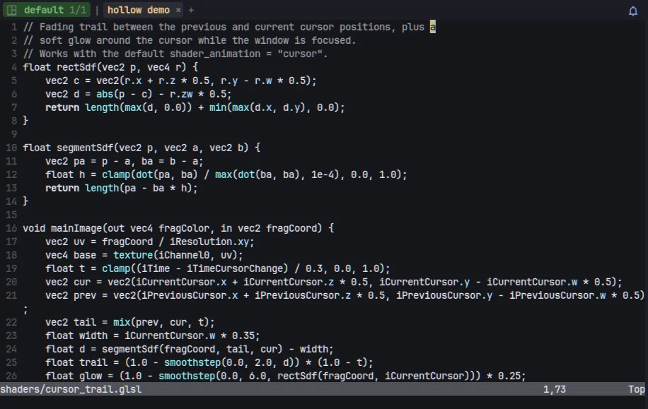

# Custom shaders

Hollow runs Ghostty-compatible post-process shaders over the rendered window.
Cursor trails, CRT effects and colour grading written for Ghostty work unchanged.

## Configuration

```lua
hollow.config.set({
  custom_shader = {
    "C:/Users/me/shaders/cursor_smear.glsl",
    "C:/Users/me/shaders/crt.glsl",
  },
  shader_animation = "cursor",
})
```

`custom_shader` accepts a path, a list of up to 8 paths, or `false` to turn shaders off.
Shaders run in order: each one samples the output of the previous one.
Use absolute paths; relative paths resolve against Hollow's working directory.

`shader_animation` controls when Hollow renders frames that nothing else asked for:

| Value                | Behaviour                                                       |
| -------------------- | --------------------------------------------------------------- |
| `"cursor"` (default) | Keep rendering for one second after the cursor or focus changes |
| `"always"` or `true` | Render every frame, for shaders that animate on their own       |
| `"off"` or `false`   | Render only when the terminal changes                           |

Shader files are compiled when the config sets `custom_shader`.
After editing a shader, run `hollow.config.reload()` to recompile it.
A shader that fails to compile is skipped and the error goes to the log file.

## Examples

[`examples/shaders/`](../examples/shaders/) has shaders to start from:

- `cursor_trail.glsl` draws a fading trail behind the cursor and a soft glow around it.
- `crt_scanlines.glsl` adds faint scanlines and an RGB fringe.




[Background shaders](background.md#background-shader) draw under the terminal instead of over it:

- `aurora_background.glsl` draws slow aurora bands.
- `matrix_rain.glsl` draws falling green glyph rain.
- `synthwave.glsl` draws a striped sunset over a scrolling neon grid.

Chain them to try both:

```lua
local shaders = "/path/to/hollow/examples/shaders/"
hollow.config.set({
  custom_shader = { shaders .. "cursor_trail.glsl", shaders .. "crt_scanlines.glsl" },
})
```

## Writing shaders

Shaders use the Shadertoy entry point:

```glsl
void mainImage(out vec4 fragColor, in vec2 fragCoord) {
    vec2 uv = fragCoord / iResolution.xy;
    vec4 color = texture(iChannel0, uv);
    fragColor = vec4(color.rgb * vec3(1.0, 0.9, 0.8), color.a);
}
```

`iChannel0` holds the terminal frame, or the previous shader's output.
Do not declare uniforms yourself; Hollow provides them.

| Uniform                       | Type           | Meaning                                          |
| ----------------------------- | -------------- | ------------------------------------------------ |
| `iResolution`                 | `vec3`         | Framebuffer size in pixels                       |
| `iTime`, `iTimeDelta`         | `float`        | Seconds since the shaders loaded, frame time     |
| `iFrame`, `iFrameRate`        | `int`, `float` | Frame counter and rate                           |
| `iDate`                       | `vec4`         | Year, month (0-based), day, seconds of day (UTC) |
| `iCurrentCursor`              | `vec4`         | Cursor rectangle: `xy` corner, `zw` size         |
| `iPreviousCursor`             | `vec4`         | Cursor rectangle before the last move            |
| `iCurrentCursorColor`         | `vec4`         | Cursor colour                                    |
| `iPreviousCursorColor`        | `vec4`         | Cursor colour before the last change             |
| `iCurrentCursorStyle`         | `int`          | One of the `CURSORSTYLE_*` constants             |
| `iPreviousCursorStyle`        | `int`          | Style before the last change                     |
| `iCursorVisible`              | `int`          | `1` when the terminal shows the cursor           |
| `iTimeCursorChange`           | `float`        | `iTime` of the last cursor change                |
| `iFocus`, `iTimeFocus`        | `int`, `float` | Window focus and when it was last gained         |
| `iBackgroundColor`            | `vec3`         | Terminal background                              |
| `iForegroundColor`            | `vec3`         | Terminal foreground                              |
| `iCursorColor`, `iCursorText` | `vec3`         | Cursor and cursor text colours                   |
| `iSelectionBackgroundColor`   | `vec3`         | Selection background                             |
| `iSelectionForegroundColor`   | `vec3`         | Selection foreground                             |
| `iPalette[256]`               | `vec3`         | The 256-colour palette                           |

The cursor style constants are `CURSORSTYLE_BLOCK`, `CURSORSTYLE_BLOCK_HOLLOW`, `CURSORSTYLE_BAR`, `CURSORSTYLE_UNDERLINE` and `CURSORSTYLE_LOCK`.

Cursor uniforms follow the focused pane and update only while the cursor is drawn, so a blinking cursor keeps its last position.

### Coordinates

Like Ghostty, shaders see the graphics API's native coordinates:

- Windows (Direct3D 11): `fragCoord` starts at the top-left and `y` grows downwards.
- Linux (OpenGL): `fragCoord` starts at the bottom-left and `y` grows upwards.

`iCurrentCursor.xy` is the cursor's left edge on the `+y` side, as in Ghostty, so shaders written for Ghostty place the cursor correctly on both platforms.

`HOLLOW_Y_DOWN` is defined as `1` on Windows and `0` on Linux.
Shaders that need a fixed "up", such as falling rain, can flip `fragCoord.y` with it:

```glsl
#ifndef HOLLOW_Y_DOWN
#define HOLLOW_Y_DOWN 0 // other terminals, such as Ghostty
#endif

vec2 uv = fragCoord / iResolution.xy;
#if HOLLOW_Y_DOWN
uv.y = 1.0 - uv.y; // y now grows upwards on every platform
#endif
```

## Limits

- Shader files are limited to 256 KiB.
- Shaders are disabled when the window uses multisampling.
- Only `iChannel0` is bound; `iChannel1` to `iChannel3` are not declared.
- `iMouse` is always zero.
