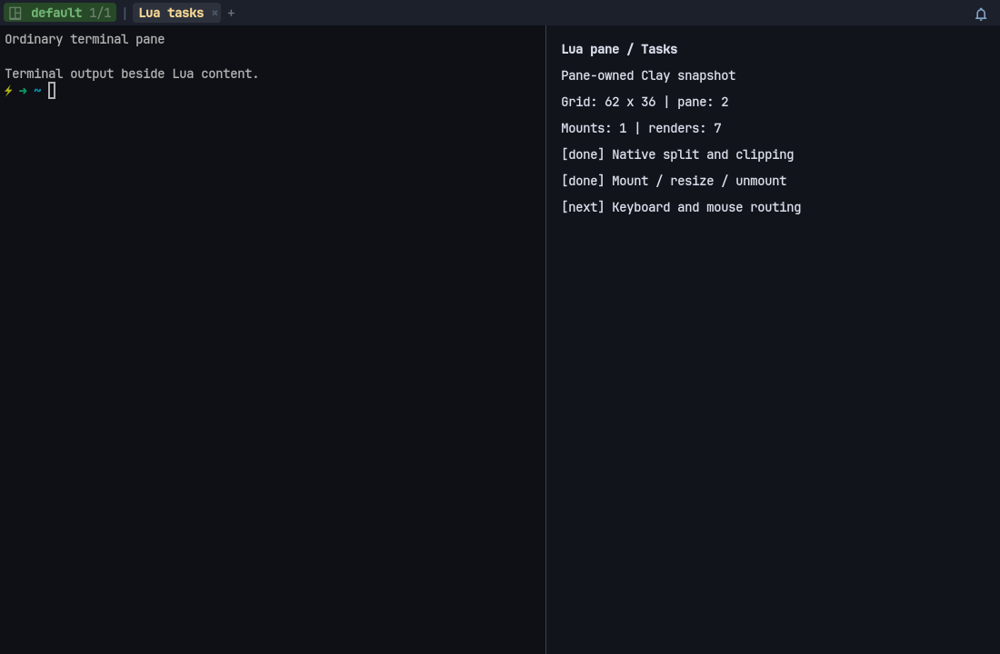
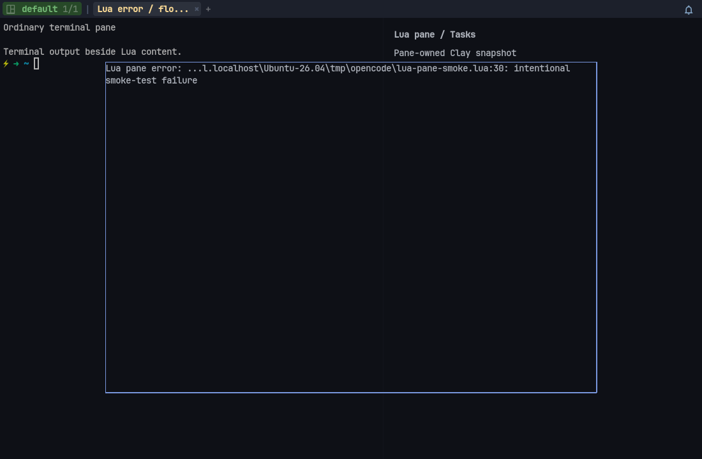
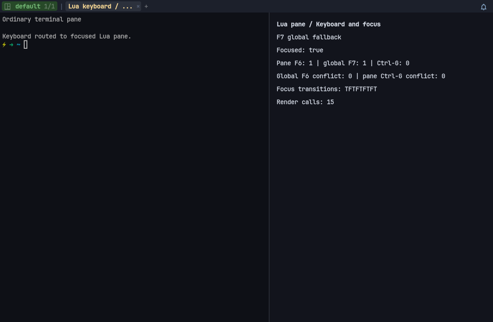
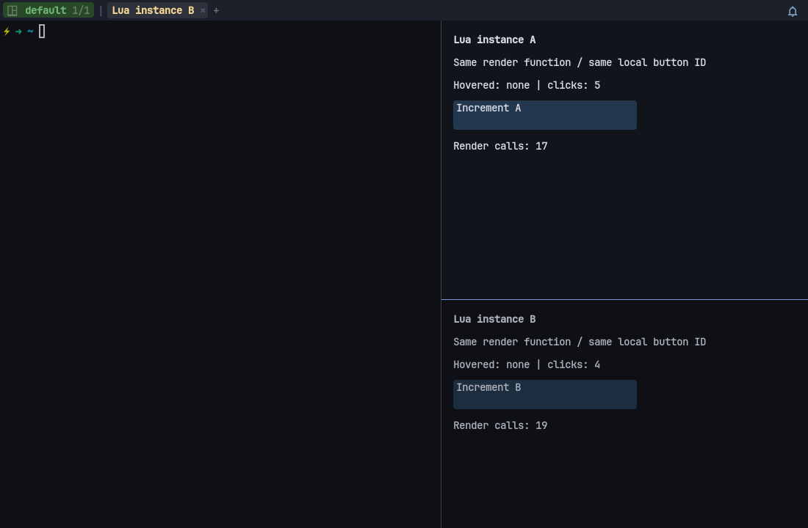
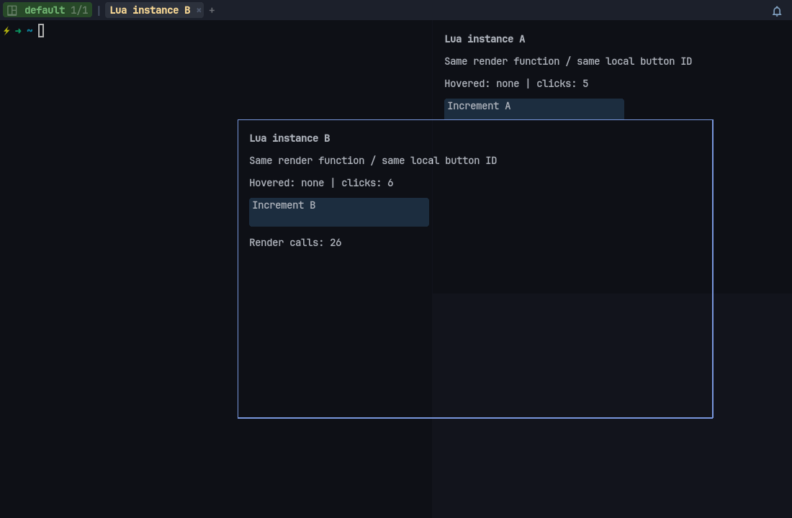

# Lua pane plan: panes whose content is a Lua UI tree

Handoff document. Goal: a split or floating pane whose content comes from a Lua
`render(ctx)` function using the declarative `hollow.ui` API, laid out, focused
and closed like a terminal pane.

Non-goals (v1): scrolling viewports, text selection or copy mode in Lua panes,
running Lua panes inside the agent process, reactive state/hooks.

---

## 0. Ground rules

- Terminal panes must behave exactly as before. Any change in terminal
  rendering, input, or lifecycle output is a bug.
- Every checkpoint compiles and passes the full suite on its own (see §8).
  `zig fmt` on touched Zig, `stylua --check` on touched Lua.
- Don't commit unless the operator says so. Keep each step reviewable alone.
- If the plan is wrong, record it under "Findings", take the smallest safe
  adjustment, continue.

---

## 1. Decisions

- **Pane model: Option B** (generic node + typed terminal content). An interim
  Option A (`Pane.kind` + `isTerminal()` guards) shipped first as a tested
  safety net. Its audit found 55 guard branches instead of the ~19 estimated,
  which met the switch trigger, and the operator chose B. The tagged union
  landed in B3.
- **Pane IDs** are explicit (`Pane.id`, allocated monotonically by `Mux`, 0
  means unpublished), not pointer addresses.
- **Rendering: reuse Clay surfaces.** The original plan to extract an overlay
  row drawer (`drawSurfaceRows`, `serialize_surface_row`) is obsolete:
  overlays already build `ui.layout` surfaces and publish Clay snapshots.
  `hollow.ui.layout` owns dirty snapshots, render revisions, per-surface
  callback tables, namespaced IDs, keyboard focus and destruction. Its native
  adapter is `src/ui/clay_surface.zig`. Lua panes reuse these with pane
  ownership, clipping to the pane rect, and pane-local input routing. Overlay
  and sidebar rendering stay unchanged.

---

## 2. Target model

```zig
// src/pane.zig: generic node, keeps the name
pub const Pane = struct {
    id: usize,                       // explicit, 0 = unpublished
    allocator, host_context,
    // geometry: x_px, y_px, width_px, height_px, cols, rows
    // floating/restore: is_floating, floating_*, restore_*
    // shared status: title, cwd, foreground_process, program_status, bell_*
    // retained-texture damage: render_dirty, title_dirty, cwd_dirty
    content: Content,

    pub const Content = union(enum) {
        terminal: TerminalPane,      // src/term/terminal_pane.zig
        lua: *LuaSurface,            // src/ui/lua_surface.zig
    };
    pub fn initLua(allocator, surface: *LuaSurface) Pane; // owns surface
    pub fn asTerminal(self: *Pane) ?*TerminalPane;
    pub fn asLua(self: *const Pane) ?*LuaSurface;
};
```

Terminal-only code takes `*TerminalPane`. Generic code narrows once at its
entry point (`pane.asTerminal() orelse ...`) or switches on `content`. Native
Ghostty callbacks and HTP keep the stable node as userdata and reject
non-terminal nodes.

---

## 3. Status

### Done (committed)

| Commit | Checkpoint |
| --- | --- |
| `1605305` | Explicit `Pane.id`; lookup, events, HTP, snapshots, `HOLLOW_PANE_ID`, restore anchors |
| `0677d49` | Option A safety net: `Pane.Kind`, owned `LuaSurface`, shared split/float insertion (`splitActivePaneWith`), terminal guards; `TerminalPane` started (PTY + encoders) |
| `552ea60` | Ghostty handles, render-helper lifecycle, and readiness flags move to `TerminalPane` |
| `5940ff6` | Protocol buffers, notification assembly, and startup-input queue move to `TerminalPane` |
| `5c06949` | Runtime state (spawn/domain, HTP, PTY timing, sync output, mouse, images, jobs, scrollbar) moves to `TerminalPane` |
| `0ea9eed` | Bootstrap, PTY poll, parsing, title/cwd refresh, and resize move to `src/term/pane_runtime.zig`; PTY limits in `src/term/pty_policy.zig` |
| `06263fb` | Selection, scrolling, hyperlinks narrowed to `*TerminalPane` |
| `5024e8d` | Copy mode, quick select, screen/text queries narrowed; `TerminalPane.beginRead` borrows render helpers |
| `3d65006` | B1: input, paste, HTP, jobs, native callbacks, app frame loop, resize, renderer, mux and Lua callbacks narrowed. Only tests read `pane.term` outside `src/term/` and `src/pane.zig`. Adds `Pane.domainName()`; fixes the missed HTP guard |
| `2b80845` | B2: terminal pass-through methods removed from `Pane`. Callers use `TerminalPane` methods after narrowing; `pollPty`, `bootstrap` and `nudgeTerminal` take the node explicitly. `Pane` keeps only content-dispatching operations: `deinit`, `invalidate`, `resize`, `applyTerminalTheme`, `refreshTitle`, `refreshCwd`, `setCwd`, `setManualTitle`, `domainName` |
| `bfb6722` | B3: `kind`/`term`/`lua_surface` replaced by `content: Content` (`terminal: TerminalPane`, `lua: *LuaSurface`); `Pane.initLua` takes surface ownership; `asLua()` added. Inactive-arm access now panics in safe builds, so tests that flipped `kind` in place use separate Lua panes. Remaining `isTerminal()` calls are behaviour gates (reject, skip, return early) and stay |
| `7a4ed3b` | B4: Windows GUI A/B, `5024e8d` vs `bfb6722`; no regression (see §8) |
| `92b2041` | P1: pane-owned Clay snapshots, clipping, retained pane textures, dirty-only Lua rendering |
| `4948a4a` | P2: public creation/lookup/instance API, mount/unmount/resize hooks, error rows, reload-safe ownership; Windows GUI smoke screenshots |
| `d5882c4` | P3: keyboard/global routing, pane-local surface focus, OS/mux focus hooks, blur-before-unmount; Windows GUI smoke screenshot |

### Remaining

| Step | What |
| --- | --- |
| P4 | Implemented, uncommitted: pane-local clicks/hover and keyboard focus on click; copied namespaced node IDs with runtime/snapshot/layout guards; isolated two-instance/float GUI validation and offscreen rectangle-pipeline fix below |
| P5 | Snapshots/CLI `kind`, `module` + factories, workspace `lua` leaf (§5) |
| P6 | Types (`types/hollow.lua`) and docs (`docs/reference/lua/ui.md`, `docs/custom-ui.md`) |
| later | Scroll viewports for Lua panes; more content kinds (one union arm each) |

**Done when (v1):**
- A Lua pane can be split, floated, zoomed, focused, moved to another tab and
  closed. It is never reaped automatically.
- It renders only when dirty (verified by a counter in tests).
- Keys reach `on_key` when focused; global keybindings still work.
- Clicks and hover work with two instances of the same module open.
- Snapshot shows `kind = "lua"`; a factory-backed pane comes back after a
  workspace reload.
- Terminal behaviour unchanged: full Zig and Lua suites green, benchmarks within
  noise.

---

## 4. Lua API

P2/P3 implement creation, lookup, instance methods and lifecycle/input hooks.
`register`/factory restore remain P5.
Creation reserves an ID immediately and queues layout insertion on the frame
thread. Returns `nil` when unavailable (for example, before GUI initialization).
Mount runs once at the first snapshot with valid pane geometry; unmount runs
once on destruction for mounted instances. Closing before first paint does not
invoke mount/unmount. `on_resize` receives subsequent geometry changes.
`on_focus(ctx, focused)` reports initial focus after mount and subsequent mux/OS
focus transitions (deduplicated), then blur before unmount when needed.
`ctx.focused` includes OS window focus. `on_key(key, mods, ctx)` receives key-down
and repeat events, using normalized key names and canonical modifier strings
(`""`, `"<C>"`, `"<S>"`, etc.). Only `true` consumes the key. Errors log and fall
through rather than trapping global shortcuts. Key-up and text/IME callbacks are
not exposed in v1. Terminal-only CLI send helpers still reject Lua panes.
Routing priority: overlays/modal handlers and pending global sequences first;
modified global bindings next; then pane-local surface focus, `on_key`, and Tab
navigation; finally unmodified global bindings when the pane declines. Copy-mode
bindings keep their existing priority. A handled pane key invalidates its surface.
P4 routes left-button presses to declarative `on_click` callbacks, using each
pane's own layout namespace. Callback `event.id` remains the local node ID.
Blank presses focus the pane without terminal selection; releases/drags belonging
to Lua presses never reach terminal panes. Native hover paint and optional
`ctx.hovered_id` (local ID or `nil`) update on node transitions, not every pixel.
Hover also clears when panes/nodes become occluded, hidden or destroyed. Root
buttons work too. Scrolling/drag widgets and text selection remain outside v1.
Config reload unmounts against the old runtime and drops native snapshots; until
P5 restore exists, old Lua pane nodes remain blank and can still be closed.

```lua
local pane = hollow.ui.pane.split({
  direction = "vertical",      -- or "horizontal"
  ratio = 0.4,
  title = "Tasks",
  module = "tasks",            -- optional; required for restore (§5)
  render = function(ctx)
    -- ctx.cols, ctx.rows, ctx.focused, ctx.pane_id, ctx.theme, ctx.state
    return ui.column({ ... })
  end,
  on_key = function(key, mods, ctx) return true end,   -- true = handled
  on_mount = function(ctx) end,
  on_unmount = function(ctx) end,
  on_resize = function(ctx) end,
  on_focus = function(ctx, focused) end,
  state = {},
})

hollow.ui.pane.float(opts)      -- same options, floating
pane.id                          -- matches hollow.term pane IDs
pane:invalidate()
pane:set_title(title)
pane:close()
hollow.ui.pane.get(id)           -- instance or nil
hollow.ui.pane.register(name, factory)   -- factory(args) -> opts, used by restore
```

- New module `hollow.ui.widgets.pane` (files under `src/lua/hollow` are
  embedded automatically). `render` output becomes a `ui.layout` surface owned
  by the pane; callback IDs are namespaced per pane instance and released on
  close.
- Re-render triggers: `invalidate()`, resize, focus change, theme change,
  hover change. No per-frame Lua call when idle.
- Errors in `render` show an error row in the pane instead of crashing;
  unknown-token errors still propagate in tests.
- Terminal-only CLI verbs (send-text and similar) return `error.NotATerminal`
  for Lua panes; Lua send helpers return `false`. Already implemented.

---

## 5. Persistence and process model

- Lua panes live in the GUI process only. The agent (`src/agent`) never sees
  them. On reattach, terminal panes come back from the agent; the GUI rebuilds
  Lua panes.
- Functions can't be serialized, so restore goes through named factories:
  snapshots store `{ kind = "lua", module = "tasks", args = {...} }` and the
  layout loader calls the factory registered with `hollow.ui.pane.register`.
  A Lua pane without `module` is not restored (documented).
- Workspace layouts (`ui/workspace/source.lua` and the host layout loader) gain
  a `lua` leaf: `{ lua = "tasks", args = {...} }`.
- `hollow-cli`: listing shows `kind`; a `split --lua <module>` verb is optional.

---

## 6. Tests

- Zig: mixed terminal/Lua split, float, unfloat, zoom, close, tab and workspace
  moves; full app ticks with Lua-only layouts (exist). Add: render-only-when-dirty
  counter, Clay pane hit testing, snapshot `kind`.
- Lua (`src/lua/tests/test_ui_pane*.lua`): render caching and invalidate; ctx
  fields; callback namespace isolation; error row on render failure; factory
  restore.
- Screenshots of a sample pane with the `hollow-screenshots` skill.

---

## 7. Open questions

- Pane-local key priority resolved in P3: explicit-modifier global bindings first,
  pane keys before unmodified global bindings; overlay/modal and pending sequence
  capture stays ahead of both. See §4.
- Should a Lua pane embed a terminal later (a "terminal widget")?
- Theme: terminal theme, widget theme, or a per-pane `theme` override?
  (Proposed: widget theme plus `opts.theme`.)
- Should the sidebar become a reserved Lua pane once panes exist?

---

## 8. Validation environment

- Plain `make test` cannot link here (no X11, Xi, Xcursor, GL, ALSA). Use Nix:
  `nix-shell --run 'make build ARGS="-Ddynamic-linker=$HOLLOW_DYNAMIC_LINKER"'`
  and the same with `make test`. Run `make build` as well as `make test`: Zig's
  lazy analysis otherwise misses renderer-only consumers such as the debug
  overlay.
- `make test-lua` baseline: 785 successes. Unchanged at every checkpoint so far
  (no Lua changes yet).
- The headless renderer benchmark owns a separate `Session`, so it can't
  measure the pane-ownership refactor. Use the Windows GUI A/B instead:
  cross-build ReleaseFast for both commits (a baseline worktree needs
  `third_party/*` symlinked and `zig-pkg` copied, not symlinked), run each
  `hollow-native.exe` as a separate instance with a minimal `--config`
  (1280x800, WSL mux domain), and type the workload driver into its first
  pane via `hollow-cli` using the shell's `HOLLOW_*` env. The mux agent
  ignores the domain `shell` and starts the login shell. GUI CPU comes from
  `Get-Process` filtered by exe path.
- B4 result (mean of 3 interleaved runs, 143x44 grid, mux mode):

  | Workload | `5024e8d` | `bfb6722` |
  | --- | ---: | ---: |
  | repaint 20k, frames/s | 5743 | 5893 |
  | repaint, GUI CPU s | 4.29 | 4.16 |
  | scroll 500k, lines/s | 72754 | 74953 |
  | scroll, GUI CPU s | 8.34 | 8.09 |
  | split-scroll 1000 @100 Hz, GUI CPU s | 1.34 | 1.38 |
  | sync-output 1000 @100 Hz, GUI CPU s | 3.09 | 2.96 |

  Differences are within run-to-run spread (about 5%).
- Leave the modified submodules (`third_party/*`) alone.
- `make test` failed once in 9 runs during B1, with no assertion output; the
  log just before it showed agent-PTY/`signal=9` warnings. It looks like an
  existing timing-sensitive PTY test, but this isn't confirmed. If it comes
  back, capture the full log to get the test name.

---

## Findings

- **Guard count.** The Option A table grouped several entry points per row
  and missed focus-callback rebinding, native word/line selection, and
  terminal screen/text queries. That gave 55 branches instead of ~19, which
  triggered the switch to B.
- **Leak in `recreateRenderHelpers`.** It used `errdefer` in a void function
  whose allocation catches returned normally, so partial failures leaked
  handles. It is now a fallible transaction, with failure-injection tests.
- **Bootstrap ownership.** Bootstrap installs userdata/callbacks before
  parsing and moves locals into `TerminalPane` only after the PTY is created.
  It moves input handles one at a time so rollback never frees protocol
  buffers that are already owned.
- **Missed HTP guard.** External shell command observations could assign
  terminal automation state to a Lua node. Fixed, with a regression test.
- **Sidebar/overlay row drawer.** Obsolete (see §1). The UI moved to Clay
  (`b487744`, `002392a`) after this plan was written.
- **P1 native surface ownership.** `LuaSurface.attach` binds a registry reference
  to a `ui.layout` surface and its Lua runtime generation. Native preparation
  invokes `invalidate`/`snapshot(ctx)` only on invalidation or viewport/focus/cell
  changes. It retains parsed nodes and owned strings without publishing the
  standalone/overlay `_layout_*` globals. A stale generation disables the old
  reference rather than resolving its registry index in a new runtime.
- **P1 rendering.** Lua panes use the existing pane texture cache and Clay paint
  commands clipped to their local rect. Text is pre-rasterized before atlas
  upload/offscreen passes. Texture/atlas invalidation repaints retained nodes;
  it does not rerun Lua when the snapshot is clean. Diagnostic terminal direct
  paths keep Lua texture blits in layout order, including floating panes.
- **Headless dependency boundary.** Embedding a typed Clay surface in
  `LuaSurface` made headless background-pane tests require GUI bindings. Native
  storage is instead allocated lazily with an erased destruction callback;
  headless lifecycle code never imports or links Clay. Repeated destruction
  releases both host and native ownership exactly once.
- **P1 validation.** Native build, full Zig suite (including headless background
  panes), 785 Lua tests, touched Zig formatting, and `git diff --check` pass.
  Native regressions check dirty-only snapshot counts, resize/focus triggers,
  independent Clay contexts, owned text, translated hit bounds, unchanged overlay
  publication, Lua stack balance, stale-runtime rejection, and cleanup. No public
  pane creation API exists yet; error-row/lifecycle/input/persistence work and
  real GUI screenshot/performance validation remain pending.
- **P2 ownership/lifecycle.** `src/app/lua_panes.zig` queues native creation,
  invalidation and title updates; Mux reserves IDs atomically so callbacks never
  insert layouts or race terminal ID allocation. Registry references carry runtime
  generations through insertion, cancellation and destruction. Unmount runs before
  releasing the reference, including close/tab teardown and config reload. Shutdown
  drains actions queued by unmount hooks before destroying Lua. Failed insertion
  destroys the unpublished owner; stale queued references never enter a new runtime.
- **P2 validation.** Native build, Windows dev cross-build, full Zig suite and
  793 Lua tests pass. Added host API creation/title/invalidation/close/rollback/
  cancellation/reload tests plus eight Lua API tests. Formatting and
  `git diff --check` pass. Windows GUI smoke checks used a disposable 1100x720
  instance with a WSL mux terminal: mixed split/clipping, floating render-error
  row, resize hook, close/unmount, and reload cleanup. Idle render count stayed
  at 2 across separate probes; explicit invalidation increased it to 3. Mount
  stayed at 1; float close and reload each added one unmount. Demo instances
  were closed; existing operator instance/submodules left untouched. No new
  throughput benchmark was run (B4 remains the terminal-performance baseline).

  

  
- **P3 input/focus.** Pane key dispatch lives in the existing shared Lua keymap,
  so key/CHAR swallowing and terminal routing stay unchanged. Focus notifications
  enter Lua under its runtime lock and generation guard; no Clay dependency leaks
  into headless lifecycle paths. Native pane snapshots now include OS focus, not
  just active-pane identity. The last snapshot context stays separate from live
  focus context so a focus event cannot swallow a pending resize notification.
- **P3 validation.** Native build, Windows dev cross-build, full Zig suite and
  801 Lua tests pass. Eight new Lua tests cover priority/fallback, callback errors,
  nonfocused/unmounted/closed panes, overlay/sequence capture, Tab/activation,
  deduplicated focus and blur-before-unmount cleanup. Native host tests cover mux
  and OS focus, stale-runtime rejection and unchanged reference ownership.
  Windows GUI validation used targeted synthetic Win32 focus/F6/F7 events on a
  disposable instance: F6 reached the pane exactly once without running its
  conflicting global binding; declined F7 reached its global binding exactly
  once. CLI left/right pane switches produced blur/focus transitions. Modified
  global priority is covered by Lua tests (not physical keyboard automation).
  Screenshot PNGs are losslessly compressed with normal file permissions.
  Demo instance closed; P4 mouse routing is next.

  
- **P4 pointer ownership.** The renderer hit-tests clipped pane rectangles in
  reverse paint order, then the owning Clay surface. It copies node IDs into
  frame-thread events; delivery verifies pane/runtime identity, snapshot revision
  and layout generation. Clicks focus the pane before dispatching through its
  surface's callback table. Hover IDs are pane-owned; same-node pixel motion
  updates coordinates without entering Lua or invalidating snapshots. Post-layout
  probes clear stationary hover after geometry/overlay changes. Lua press latches
  prevent selection, drag motion and releases from leaking into terminal input.
- **Colored-pane pipeline finding.** First P4 Windows GUI run aborted in D3D11
  validation: colored buttons loaded the swapchain rectangle pipeline into an
  RGBA8 offscreen pane pass. P1/P2/P3 screenshots only exercised text, so missed
  it. Lua pane caches now lazily own a straight-alpha rectangle pipeline with
  offscreen color/depth formats; Lua painting temporarily selects it and restores
  the swapchain pipeline afterward. Pipeline pools cover the additional lazy
  resource. Terminal caches/painting do not select or allocate this UI pipeline.
- **P4 validation.** Native build, Windows dev cross-build, full Zig suite,
  808 Lua tests, formatting and `git diff --check` pass. Seven new Lua tests cover
  identical local IDs in independent instances, hover context/leave, click focus,
  root buttons, closure/retired callbacks and callback errors. Native regressions
  cover clipped root hits, opaque pane order, hover deduplication, copied-event
  cleanup, stale runtime/snapshot/layout rejection and rectangle pipeline formats.
  Release-latch tests also cover newly opened modal routing and preserve
  terminal-origin releases; terminal selection drags retain their existing path.
  Windows GUI smoke used two panes sharing a render function and `increment` ID:
  independent click-counter deltas, hover enter/leave, unchanged render counts
  during same-button motion, opaque floating panes, and overlay click blocking
  (the underlying counter resumed after overlay removal). Colored controls and
  screenshots work after the pipeline fix. Cursor position restored and demo
  instance closed. No new throughput benchmark was run. P5 persistence is next.

  

  
