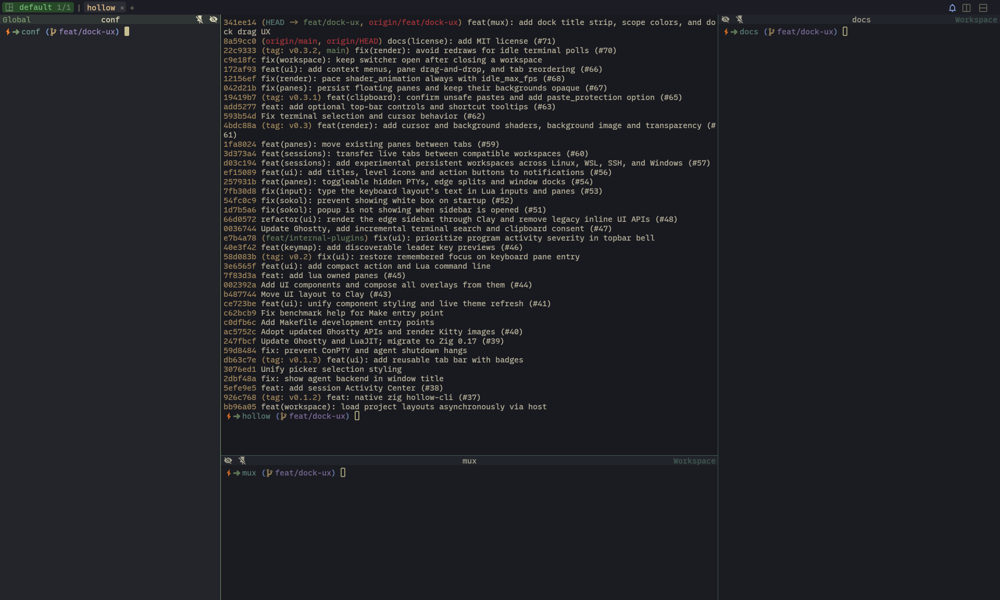
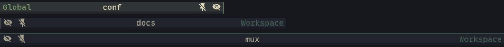
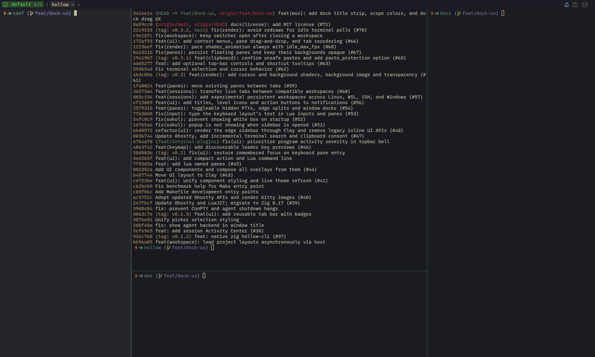

# Drag panes and tabs

Move the pointer near the top of a tiled pane to reveal its handle, then grab it at the top center.
Drag over another pane's left or right edge to split beside it, or over the top or bottom edge to split above or below it.
Drag to the center to swap the panes.
The highlight covers the chosen half of the target pane for a split, or an inset rectangle for a swap.

To move a pane to another tab in the same workspace, drop it on that tab's label for a side-by-side split.
Alternatively, pause over the tab to see a layout map, then drop on another pane in that map to choose exactly where the dragged pane goes.
The preview does not activate the destination tab or resize its terminals.
The running pane and its scrollback move with it.

To reorder tabs without moving panes between them, drag a tab label to the left or right of another label.
An insertion line shows where the tab will go.
Tab dragging only reorders tabs in the current workspace.

## Floating panes

Hover near the top of a floating pane to reveal its top-center handle.
Drag the handle to the edge of a tiled pane to turn it into a split.
Drop it on another tab's label to tile it there.
Drop it on a window edge to dock it.
If the tab has no visible tiles, drop where the `Tile` preview appears.
Floating panes can't swap with tiles.
Drag the rest of the top edge to move the floating pane.
Drag its sides, bottom edge, or corners to resize it.

## Docks

Drag a pane to a window edge to dock it there.
The preview shows the exact area the dock will take, in the dock color, with a label such as `Dock Right · Workspace`.
Tiled and floating panes become workspace docks by default.
Hold Shift while dragging to make a global dock instead.
If that edge already has a dock in the chosen scope, the edge turns red and the drop is refused.

Each dock has a title strip: a faint wash of the dock color, stronger while the dock has focus.
By default it shows hide and undock buttons on the left, the pane title in the middle, and the scope on the right.
Left docks mirror the `left` and `right` items, so their buttons sit next to the tab area.
The title follows the default tab label: the pane title, then the foreground process, then the last part of the working directory.
Hover a button or the scope to see what it does in a tooltip.
Click the scope to move the dock to the same edge in the other scope; the tooltip says when that edge is taken.
Grab the strip anywhere outside its buttons to drag the dock.
Moving a dock keeps its size and the size of the other docks.





The default layout:

```lua
hollow.config.set({
  dock_header = {
    enabled = true,
    -- Items: "hide", "undock", "title", "scope", "edge".
    left = { "hide", "undock" },
    center = { "title" },
    right = { "scope" },
  },
})
```

Each slot is optional; slots you leave out keep their defaults.
For example, this keeps only the hide button and shows the edge next to the scope:

```lua
hollow.config.set({
  dock_header = {
    left = { "hide" },
    right = { "edge", "scope" },
  },
})
```


An empty slot shows nothing, so `center = {}` drops the title.

To remove the strip entirely and give the row back to the pane:

```lua
hollow.config.set({ dock_header = false })
```



Docks then use a hover handle at the top center, with a chip naming the dock, such as `Right dock · Global`.
Narrow docks show only the scope in the chip.
Drag a dock to another edge to move it; it keeps its scope and size, and Shift flips the scope.
Drag it onto a tiled pane's edge zone to undock it there as a split.
Docks can't be swapped with tiled panes or dropped on tab labels.

Docks have a faint tint and a colored seam facing the tab area.
Workspace docks use cyan and global docks use green by default.
Set `ui.dock_active` and `ui.dock_inactive` for workspace docks, `ui.dock_global_active` and `ui.dock_global_inactive` for global docks, and `ui.dock_tint` in your theme to change them; see [Themes](themes.md).

## Canceling

Press Escape or release outside a valid target to cancel.
A small square follows the pointer while dragging a pane or tab, even when there is no valid drop target.
The cursor shows a not-allowed icon when you can't drop at the current location.
Pane drops target unzoomed tabs.
The context menu's Move commands are unchanged.
