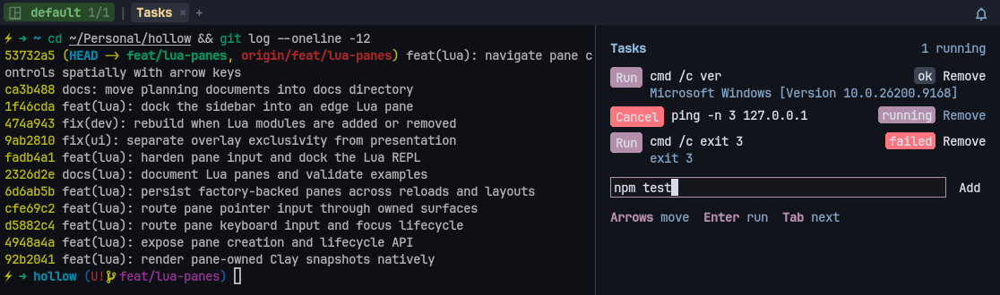

# Panes, tabs, workspaces

Hollow organizes the screen into three nested primitives.
This page defines them, shows the Lua API for each, and lists the default
keymaps.

For the full Lua surface see
[`hollow.term`](reference/lua/term.md),
[`hollow.ui.workspace`](reference/lua/workspace.md), and
[`hollow.workspace`](reference/lua/workspace-api.md).
For the keymap surface see [Keybindings](keybindings.md).

## The three primitives

| Primitive | Lifetime           | What it contains                              |
| --------- | ------------------ | --------------------------------------------- |
| Workspace | Lives until closed | One or more tabs                              |
| Tab       | Lives until closed | One or more panes (tiled + optional floating) |
| Pane      | Lives until closed | One shell process + scrollback, or Lua UI     |

A typical flow: open a workspace, open a tab in it, split the tab into
panes. A workspace is the unit of "I'm switching contexts" — close a
workspace, lose the tabs and panes inside it.

## Workspaces

Workspaces are first-class. The default keymap binds `<C-A-n>` to
`new_workspace`, `<C-A-p>` to `workspace_switcher`, and `<C-A-r>` to
`rename_workspace`. The workspace switcher is a filterable picker that
combines open workspaces, recently used ones, and configured discovery
sources.

From Lua:

```lua
local hollow = require("hollow")

hollow.term.new_workspace({
  name = "backend",
  cwd  = "C:/code/backend",
  domain = "pwsh",
})

hollow.term.set_workspace_name("frontend")
hollow.term.set_workspace_default_cwd("/srv/frontend")

hollow.term.next_workspace()
hollow.term.prev_workspace()
```

Workspaces carry an `id`, an `index` (1-based), a `name`, and a `domain`.
The active workspace is the one your new tabs land in.

The discovery surface is `hollow.ui.workspace.configure(...)`.
See [Workspace switcher](reference/lua/workspace.md) for picker options
like host-backed `sources`, `cache_ttl_ms`, `format_item`, and
`filter_item`.

## Tabs

Tabs are inside a workspace. New tabs use the active workspace's
`default_domain` unless you pass one explicitly.

```lua
hollow.term.new_tab({ domain = "UbuntuWSL", title = "server" })
hollow.term.focus_tab(tab.id)
hollow.term.close_tab(tab.id)
hollow.term.next_tab()
hollow.term.prev_tab()
hollow.term.set_title("frontend", tab.id)
```

`HollowTab` snapshots expose `id`, `title`, `index`, `is_active`, and a
list of panes:

```lua
local tab = hollow.term.current_tab()
for _, p in ipairs(tab.panes) do
  print(p.id, p.foreground_process, p.cwd)
end
```

## Panes

Panes are shells. Create one with `hollow.term.split_pane(opts)`:

```lua
hollow.term.split_pane({
  direction = "vertical",   -- or "horizontal"
  ratio = 0.4,              -- size of the new pane (0..1)
  domain = "UbuntuWSL",
  cwd = "C:/code/side",
  command = "npm run dev",
  command_mode = "send",    -- or "spawn" (no echo in pane)
  close_on_exit = false,
  floating = false,         -- true to skip the tiled layout
  fullscreen = false,       -- true to maximize after creation
  -- x, y, width, height in 0..1 for floating panes
})
```

`split_pane` accepts either `(direction, opts)` or a single options table.

### Floating and maximized

A _floating_ pane is a child of the tab but does not participate in the
tiled split tree. Bounds are normalized 0..1 in window space.

```lua
hollow.term.split_pane({
  floating = true,
  x = 0.1, y = 0.1, width = 0.6, height = 0.7,
})
hollow.term.set_floating_pane_bounds(pane_id, { x = 0.05, y = 0.1, width = 0.5, height = 0.6 })
```

A _maximized_ pane covers the tiled area; other tiled panes are hidden
unless `show_background = true` is passed to `toggle_pane_maximized`.

### Toggleable PTY utility panes

Terminal panes can live along a whole tab edge, just like docked Lua panes.
Unlike Lua panes they retain a PTY and can run interactive applications:

```lua
hollow.term.split_pane({
  edge = "right",   -- "left", "top", "bottom"
  ratio = 0.30,     -- fraction of the full tiled layout
  command = "lazygit",
  command_mode = "spawn",
  on_complete = function(result)
    if result.success then
      hollow.term.set_pane_visible(result.pane_id, false)
    end
  end,
})
```

`hollow.term.set_pane_visible(id, visible)` hides or shows either terminal
or Lua panes **without closing them**. Hidden panes remain in their tab,
retain their identity, and (for terminals) keep the PTY and process running.
The native split tree reflows around hidden tiled panes. A hidden floating
pane is absent from the visible layout and hit testing. The last visible
pane in a tab cannot be hidden. Focus moves to another visible pane when
hiding the active pane; showing a pane does not automatically steal focus.

This is *presentation visibility*, not session detach/reattach. Closing
the pane or terminating Hollow still follows the configured session
lifetime; the experimental agent mux alone does not retain PTYs after
Hollow exits. Saved workspaces and owner-backed persistent sessions
serialize the `is_hidden` presentation flag independently from their
durable PTY handles.

The pane's `is_hidden` snapshot field reports its current visibility. From
outside Hollow, use `hollow-cli pane hide|show [--id ID|--tag TAG]` (command
API: `pane_hide` / `pane_show`); `get_pane`/`get_panes` report `is_hidden`
and, for edge-docked panes, `edge`.
See [the toggleable TUI example](../examples/toggleable-tui.lua) for a
keymap that toggles a workspace-docked Claude Code agent, reusing the same
PTY rather than restarting the TUI.

Hidden panes stay discoverable:

- The default top bar shows a `󰈉 N` badge when the active tab has hidden
  panes. It takes the attention color when a hidden pane rings the bell or
  reports program attention. Clicking it opens the mux navigator filtered to
  hidden panes. Disable it with `hollow.ui.topbar.configure({ hidden_panes = false })`.
- The mux navigator (`<leader>n`) marks hidden panes with `󰈉` and
  `(hidden)`, summarizes the count on tab rows, and has a **Hidden panes**
  filter (cycle with `f`, or `ui.mux_navigator.open({ filter = "hidden" })`).
  Activating a hidden pane shows and focuses it; `v` toggles the selected
  pane's visibility without closing the navigator.

### Window docks

An edge split belongs to one tab. A **dock** is a window-edge slot that
stays on screen across tab switches, so a TUI like Lazygit or the docked
sidebar does not vanish when you change tabs:

```lua
-- Create a terminal straight into a dock...
hollow.term.split_pane({
  edge = "right",
  dock = "global",   -- or "workspace"
  ratio = 0.30,      -- share of the window content
  command = "lazygit",
  command_mode = "spawn",
})

-- ...or move an existing pane into one, and back.
hollow.term.dock_pane(pane_id, { edge = "bottom", scope = "workspace", ratio = 0.25 })
hollow.term.undock_pane(pane_id)
```

- **Global** docks show in every workspace; **workspace** docks only while
  their workspace is active. Global docks sit outermost.
- Each scope has one slot per edge. Docking into an occupied slot, or
  docking a tab's last pane, is refused. Docking an already docked pane
  moves it to the new slot.
- Docked panes are in no tab. `get_pane` reports
  `dock = { edge, scope, workspace_id?, ratio }`; `hollow.term.docks()`
  lists every docked pane (global first) and `mux_tree()` gives each
  workspace its `docks`.
- Docks take part in directional focus: moving toward a dock from the tab's
  edge enters it, and moving toward the centre returns to the tab. Drag the
  seam to resize; `resize_pane` resizes a focused dock along its axis.
- `set_pane_visible` hides and shows docks like any pane; hidden docks give
  their space back. The hidden-pane badge and the mux navigator include
  docks (navigator groups them under **Docks** and **Global docks**).
- `undock_pane` returns the pane to the active tab as an edge split of the
  same size.
  Undocking across persistent-session ownership boundaries is rejected.
  This includes moves to or from a non-persistent workspace.
  Switch to the pane's owning workspace before undocking it.
  Closing a workspace closes its docks.
- Saved workspaces keep docks: `export_current()` writes workspace docks to
  `docks` and global docks to `global_docks` (each entry carries `edge` and
  `size`). Bootstrapping restores them and skips a global dock whose edge is
  already docked.
- Owner-backed persistent sessions keep docks and hidden flags too. Workspace
  docks restore with their workspace; global docks are saved by the session
  that owns their panes, and a restored global dock whose edge is occupied by
  another session's pane becomes a tab instead. Hide/show and dock/undock
  trigger a layout save.
  Edge splits without `dock` also work in persistent workspaces.
  They span the whole tab layout.
  Closing a persistent workspace includes its session-owned global docks.
  The last tab remains until those docks acknowledge closure.
- `ui.sidebar.dock()` docks the sidebar globally (`scope` option to change),
  and `ui.pane.split({ edge = ..., dock = ... })` docks a Lua pane.

From outside Hollow: `hollow-cli pane dock <edge> [--scope global|workspace]
[--ratio N] [--id ID|--tag TAG]` and `hollow-cli pane undock` (command API:
`pane_dock` / `pane_undock`).

### Move and resize

```lua
hollow.term.move_pane("left")          -- or "right", "up", "down"
hollow.term.move_pane({ direction = "right", amount = 0.1 })

hollow.term.resize_pane("left", 0.05)  -- axis, delta (0..1)
hollow.term.resize_pane({ axis = "right", delta = -0.05 })
```

`move_pane` reorders tiled panes; for floating panes it nudges the bounds.

### Pane identity

Panes are addressable by `id`. You can also tag them and target by tag:

```lua
hollow.term.set_pane_tags({ "editor" }, pane_id)
hollow.term.add_pane_tag("watch", pane_id)
hollow.term.remove_pane_tag("editor", pane_id)

-- later
hollow.term.send_text("hello", pane_id)
hollow.term.close_pane(pane_id)
hollow.term.focus_pane_by_id(pane_id)
```

This is what makes `hollow-cli pane split --tag editor` and
`hollow-cli pane close --tag editor` work — see
[Native CLI](reference/cli/native.md).

### Pane text and process

```lua
local text = hollow.term.get_pane_text(pane_id)        -- scrollback contents
local tags = hollow.term.get_pane_tags(pane_id)
hollow.term.set_pane_foreground_process(pane_id, "vim")
```

`HollowPane` snapshots expose `id`, `kind`, `pid`, `domain`, `cwd`, `title`,
`is_focused`, `is_floating`, `is_maximized`, `has_bell`, `frame`, and
`size`. Snapshots are read-only values, not live references.

### Lua panes

A pane can show UI rendered from Lua instead of a shell. Lua panes split,
float, maximize, move, focus and close like terminal panes, but run no process
and have no scrollback. Use them for tools you want to keep open next to your
terminals: task runners, dashboards, file lists, the docked
[Lua REPL](lua-repl.md).

```lua
local c = hollow.ui.components

-- Register at config load so reloads and saved workspaces can rebuild it.
hollow.ui.pane.register("notes", function(args)
  return {
    title = args.title or "Notes",
    render = function()
      return c.column({ c.title("Notes"), c.label("Nothing yet.") }, { padding = 16 })
    end,
  }
end)

hollow.keymap.set("<leader>o", function()
  hollow.ui.pane.split({ module = "notes", edge = "right", ratio = 0.3 })
end, { desc = "open notes" })
```

Snapshots report `kind = "lua"` plus the factory `module` and `args`; guard
terminal-only calls such as `send_text` by `kind`. Inside a Lua pane, Tab and
the arrow keys move between buttons and inputs.



See [Custom UI → Lua panes](custom-ui.md#lua-panes) for a walkthrough,
[`hollow.ui.pane`](reference/lua/ui.md#lua-panes) for the full API, and
[`examples/lua-pane.lua`](../examples/lua-pane.lua) for a runnable task runner.

## Async sequencing

Most operations are queued on the frame thread.
`split_pane`, `new_tab`, and `new_workspace` accept an `on_complete`
callback that fires after the operation runs:

```lua
hollow.term.split_pane({
  direction = "vertical",
  on_complete = function(result)
    if result.success then
      print("created pane", result.pane_id)
    end
  end,
})
```

For sequential flows, use `hollow.async.run` and
`hollow.async.await`:

```lua
hollow.async.run(function()
  local split = hollow.async.await(function(resolve)
    hollow.term.split_pane({
      direction = "vertical",
      on_complete = resolve,
    })
  end)
  if split.success then
    hollow.term.set_pane_tags({ "editor" }, split.pane_id)
  end
end)
```

See [`hollow.async`](reference/lua/async.md).

## Default keymap summary

Full table on [Keybindings](keybindings.md).
The shape of the layout primitives maps to the keymap groups:

- Tabs → tabs section
- Panes → panes / focus / move / resize sections
- Workspaces → workspaces section
